 

### One engineer for the whole product

I take an idea from first screen to production: the web app, the API behind it, and the mobile app in your customers' hands.
Fewer handoffs, one person accountable, faster delivery.

 

### What I deliver

| | Web | Backend | Mobile |
|---|---|---|---|
| **Build** | Dashboards, storefronts, admin panels | REST APIs, auth, integrations | Native Android and cross-platform apps |
| **Stack** | Next.js, React, TypeScript | Node.js, TypeScript, Firebase | Kotlin, Jetpack Compose, React Native |
| **Strengths** | Fast, accessible, multi-language | Secure, documented, scalable | Offline-first, maps, push notifications |

 

### Tech stack

  

 

### Selected work

Most of my work is for clients and stays private. A short summary:

| Project | What it does | Stack |
|---|---|---|
| **Settle** | Offline IOU tracker with multi-currency support and a documented threat model | Kotlin, Jetpack Compose |
| **Marketplace** | Multi-language storefront front end | Next.js, TypeScript, next-intl |
| **Firebase admin API** | User management and secure admin operations | Node.js, TypeScript, Firebase Admin |
| **Field operations suite** | Web dashboard and Android app with voice input and maps | React, Kotlin, Google Maps |

Code walkthroughs available on request.

 

### Work with me

